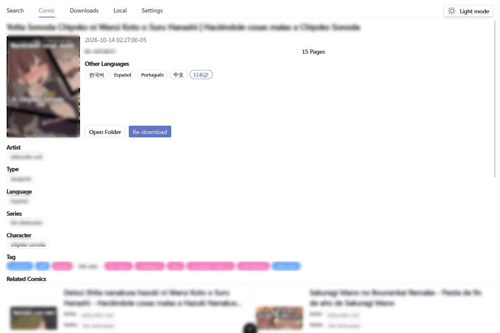
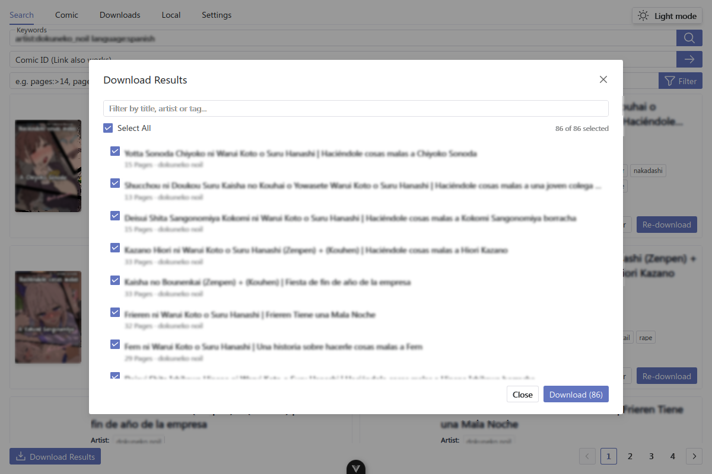
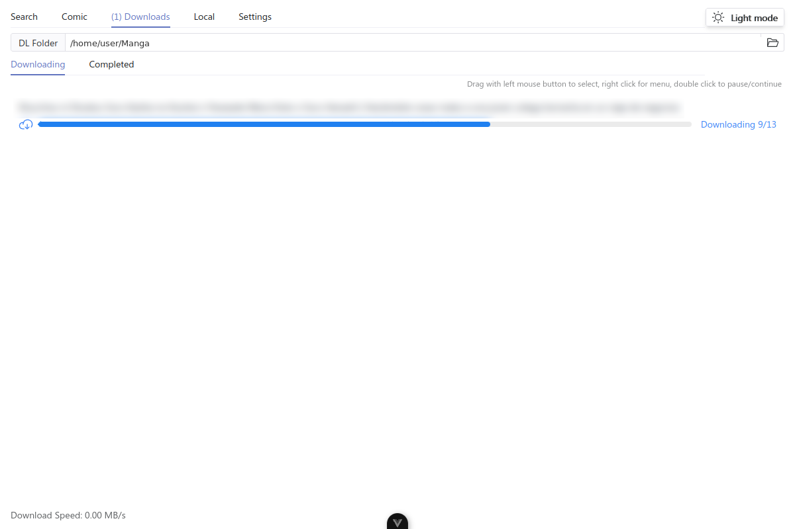
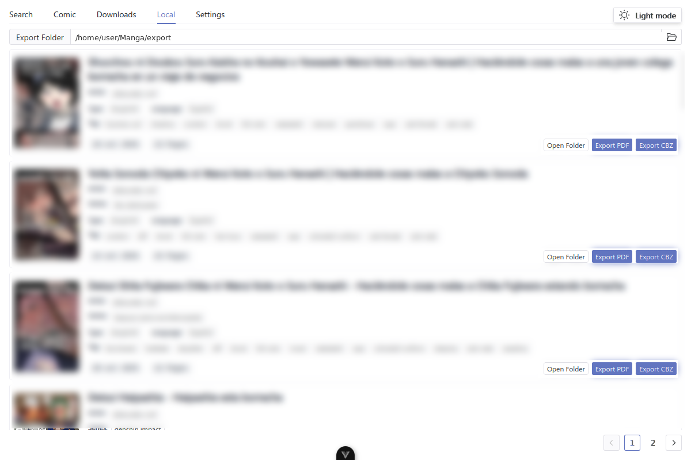
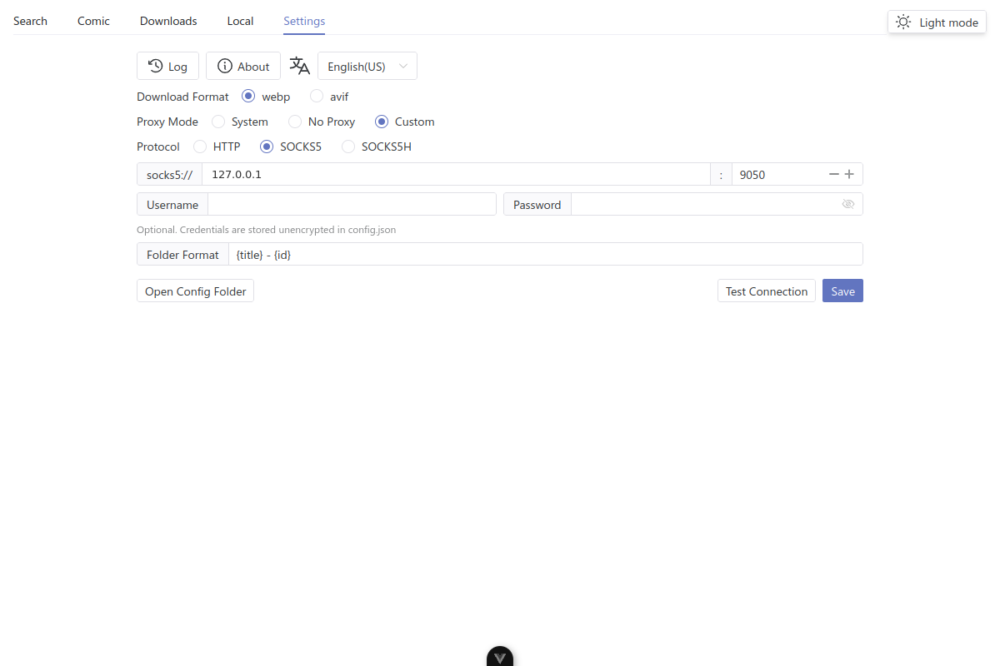
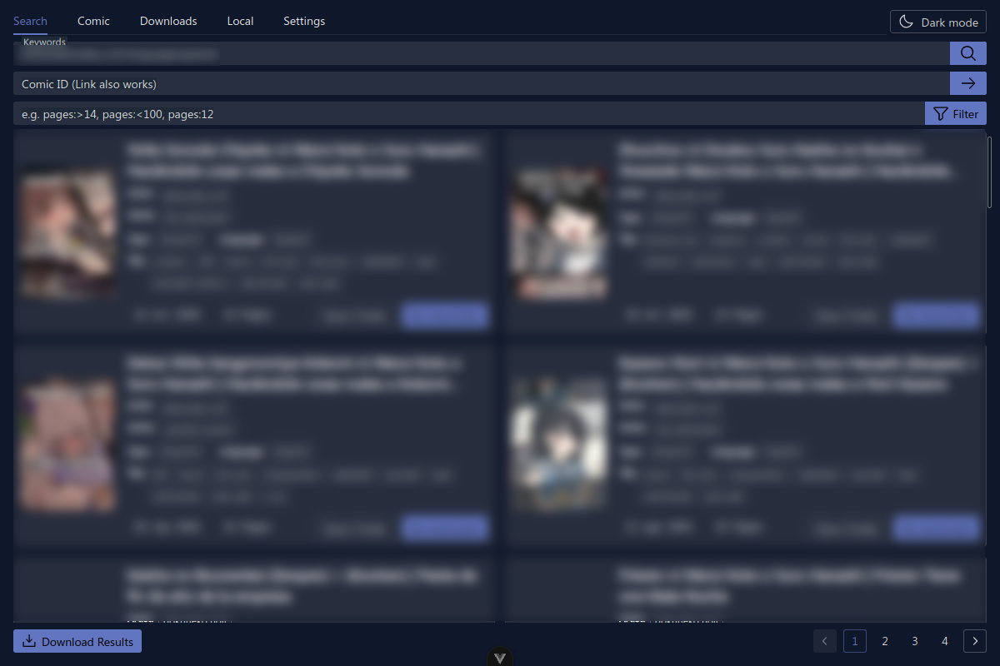

<p align="center">
    
</p>


# 📚 Hitomi Downloader

Descargador multihilo con interfaz gráfica para [hitomi.la](https://hitomi.la)

[English](./README.md) / Español / [简体中文](./README.zh-CN.md)

## 📥 Descarga

Los paquetes precompilados están disponibles en la [página de Releases](https://github.com/lanyeeee/hitomi-downloader/releases). Solo tienes que descargarlos y usarlos.

**¿Te resulta útil el proyecto? Apóyalo con una estrella⭐ en GitHub. Tu apoyo me motiva a seguir actualizándolo y manteniéndolo🙏**

## ✨ Características

| Característica                         | Descripción                                                  |
| -------------------------------------- | ------------------------------------------------------------ |
| 🖼️ Interfaz gráfica                    | Creada con [Tauri 2](https://v2.tauri.app/start/) y Vue 3: ligera, limpia y fácil de usar. |
| 🔎 Búsqueda                            | Busca por palabras clave, ID o URL de hitomi.la, con autocompletado de artistas, series, etiquetas e idiomas. |
| 🎯 Filtros                             | Acota los resultados con `pages:>14`, `pages:<100` o `pages:12`, y combina cualquier operador de hitomi.la (`artist:`, `language:`, `series:`, `group:`, `type:`, ...). |
| ⚡ Descarga multihilo                  | Maximiza la velocidad de descarga.                           |
| 📥 Descarga masiva                     | Reúne todas las páginas de una búsqueda, filtra y selecciona los cómics que quieras y encólalos de forma secuencial. |
| 🗂️ Cola de descargas                  | Progreso en vivo por cómic, con pausar, reanudar y cancelar, además de selección múltiple con clic derecho. |
| 📂 Exportación                         | Exporta con un clic a PDF o CBZ desde la biblioteca local.   |
| 🌐 Soporte de proxy                    | Usa el proxy del sistema, sin proxy o un proxy personalizado HTTP / SOCKS5 / SOCKS5H con credenciales opcionales, prueba de conexión y guardado explícito. |
| 🗂️ Estructura de directorios personalizable | Estructura de directorios y reglas de nombres muy configurables, con campos como tipo, autor, idioma, etc. Despídete de organizar las descargas a mano. |
| 🌓 Temas                               | Claro, oscuro o seguir el tema del sistema.                  |
| 🌐 Internacionalización                | Inglés, español y chino simplificado, con un sistema i18n integrado. |
| 📱 Interfaz adaptable                  | Paneles, tarjetas y diálogos se adaptan desde ventanas pequeñas hasta pantallas anchas. |

## 🖥️ Capturas

> Las capturas muestran la interfaz en inglés; la aplicación está disponible en inglés, español y chino simplificado.

### Búsqueda y filtros


### Detalle del cómic



### Descarga masiva



### Descargas y biblioteca local





### Configuración y proxy



### Modo oscuro



## 📖 Cómo usarlo

1.  En la pestaña `Buscar`, escribe palabras clave o un ID/URL de hitomi.la. Usa operadores como `artist:nombre`, `language:spanish` o `pages:>20` para acotar la búsqueda.
2.  Pulsa `Descargar` directamente en una tarjeta, o haz clic en la portada o el título para abrir la pestaña `Cómic`, revisar los detalles y los idiomas, y descargar desde ahí.
3.  Sigue el progreso en la pestaña `Descargas`. Haz clic derecho sobre una tarea para pausarla, reanudarla o cancelarla; con doble clic alternas entre pausar y reanudar.
4.  Para descargar muchos cómics a la vez, pulsa `Descargar resultados`, filtra la lista, selecciona lo que quieras e inicia la cola. Las tareas se descargan una tras otra.
5.  Los cómics terminados aparecen en la pestaña `Local`, donde puedes abrir su carpeta o exportarlos a PDF/CBZ(ZIP).

📹 El vídeo de abajo muestra el proceso completo de uso. **No tiene contenido NSFW, puedes verlo con tranquilidad.**

https://github.com/user-attachments/assets/d2d0e577-c074-41ca-996f-445d52e2cce5

## 🧭 Usar un proxy

Si hitomi.la no es accesible desde tu red, abre `Configuración` y elige un modo de proxy:

-   `System` (Sistema): reutiliza el proxy del sistema operativo.
-   `No Proxy` (Sin proxy): conecta directamente.
-   `Custom` (Personalizado): elige el protocolo (`HTTP`, `SOCKS5` o `SOCKS5H`), introduce el host y el puerto y, opcionalmente, un usuario y una contraseña. `SOCKS5H` permite que el proxy resuelva el DNS, algo útil con Tor.

Pulsa `Test Connection` (Probar conexión) para comprobar que el proxy alcanza hitomi.la y luego `Save` (Guardar) para conservar la configuración. Las credenciales se guardan en texto plano dentro de `config.json`, así que protege ese archivo en consecuencia.

## ⚠️ Sobre los falsos positivos de antivirus

En proyectos desarrollados por una sola persona, este problema es casi inevitable (~~porque requiere comprar un certificado digital para firmar el software, o incluso pagar "cuotas de protección" a las empresas de antivirus~~).
Las únicas soluciones que se me ocurren son:

1.  Compilarlo tú mismo siguiendo las instrucciones de **Cómo compilar**.
2.  Confiar en mi promesa de que todo lo que descargues desde la [página de Releases](https://github.com/lanyeeee/hitomi-downloader/releases) es seguro.

## 🛠️ Cómo compilar

Compilar es muy sencillo, solo 3 comandos.
~~Siempre que tengas instalados Rust, Node y pnpm.~~

#### 📋 Requisitos

-   [Rust](https://www.rust-lang.org/tools/install)
-   [Node](https://nodejs.org/en)
-   [pnpm](https://pnpm.io/installation)

#### 📝 Pasos

#### 1. Clona este repositorio

```
git clone https://github.com/lanyeeee/hitomi-downloader.git
```

#### 2. Instala las dependencias

```
cd hitomi-downloader
pnpm install
```

#### 3. Compila

```
pnpm tauri build
```

## 🌐 Añadir un idioma nuevo

¡Las traducciones son bienvenidas! Si quieres añadir un idioma, consulta la implementación del [PR #1](https://github.com/lanyeeee/hitomi-downloader/pull/1). Ese PR muestra cómo se añadieron los archivos de localización para `en-us`.

Pasos principales para añadir un idioma:

1.  Crea un archivo de idioma nuevo en el directorio `src/locales`.
2.  Traduce los pares clave-valor siguiendo el formato de los archivos existentes.
3.  Registra el idioma nuevo en `src/locales/index.ts`.
4.  Envía un PR.

## 🤝 Enviar un PR

**Envía los Pull Requests a la rama `develop`.**

**Si quieres añadir una función nueva, abre antes un `issue` o un `discussion` para comentarla. Así se evita trabajo en vano.**

Para el resto de casos, puedes enviar un PR directamente, por ejemplo:

1.  🔧 Mejoras de funciones existentes.
2.  🐛 Correcciones de errores.
3.  🌐 Soporte para un idioma nuevo.
4.  ⚡ Usar una biblioteca más ligera para implementar funciones existentes.
5.  📝 Revisiones de documentación.
6.  ⬆️  También se aceptan PR para actualizar dependencias.

## ⚠️ Aviso legal

-   Esta herramienta está pensada únicamente para fines de aprendizaje, investigación e intercambio. Cada usuario asume todos los riesgos asociados a su uso.
-   El autor no se hace responsable de pérdidas, disputas legales ni otras consecuencias derivadas del uso de esta herramienta.
-   El autor no se hace responsable de las acciones del usuario mientras usa esta herramienta, incluidos, entre otros, actos que infrinjan leyes o los derechos de terceros.

## Agradecimientos

[Pupil](https://github.com/tom5079/Pupil)

## 💬 Otros

Si encuentras algún problema durante el uso o quieres proponer alguna función, abre un `issue` o un `discussion`. Haré lo posible por atenderlo.
