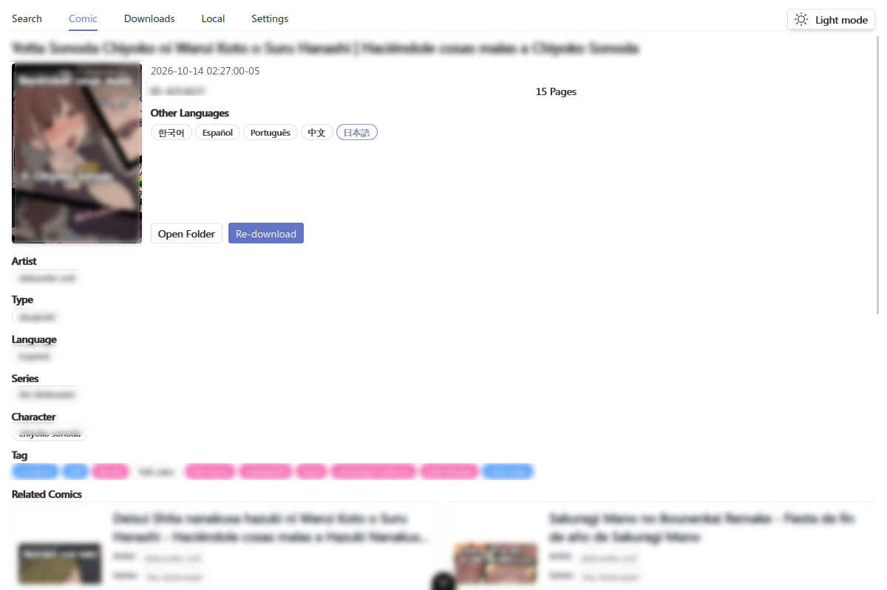
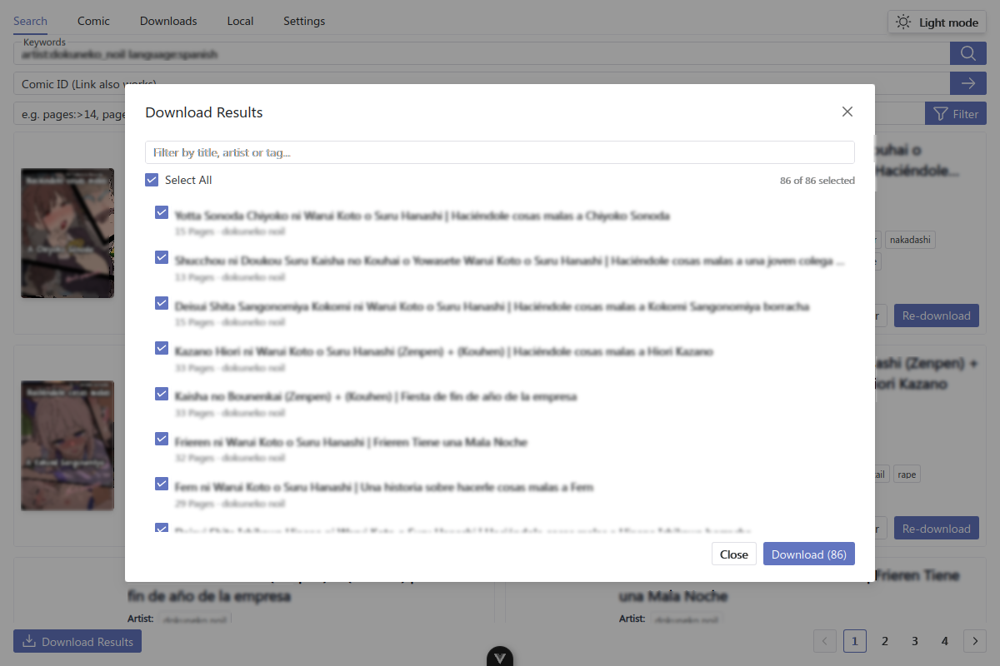
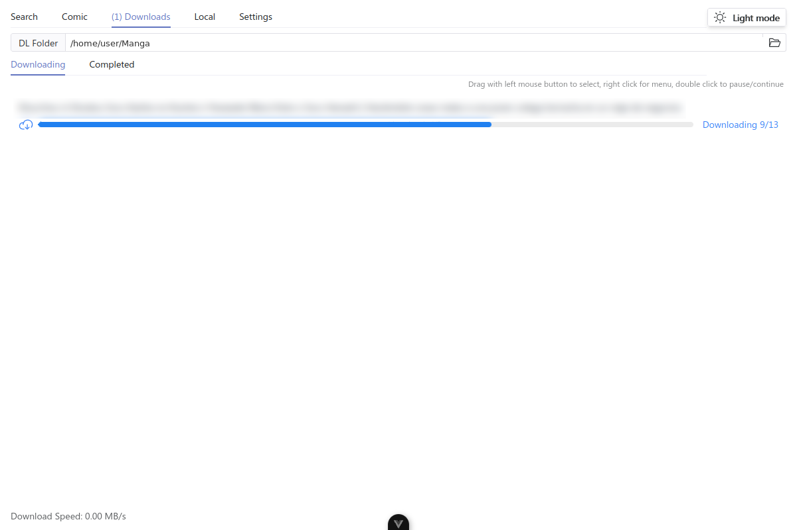
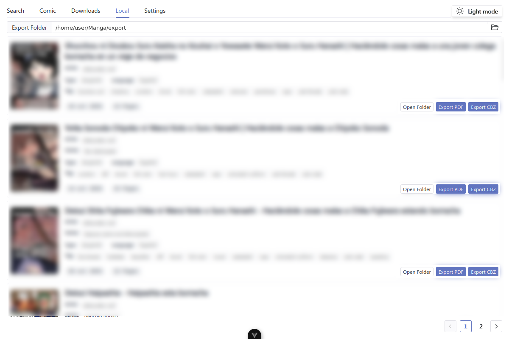
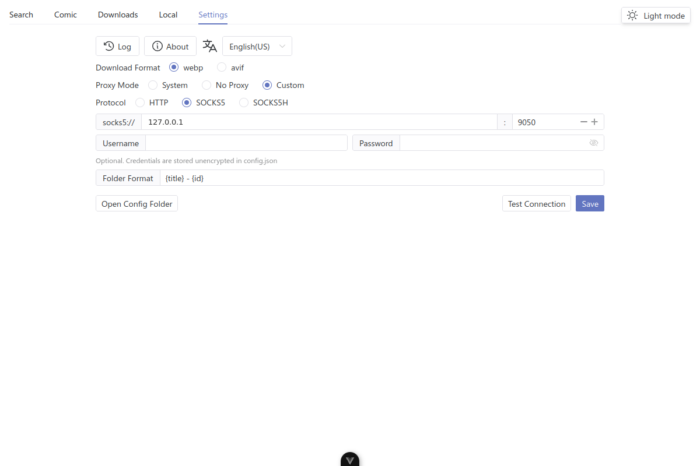
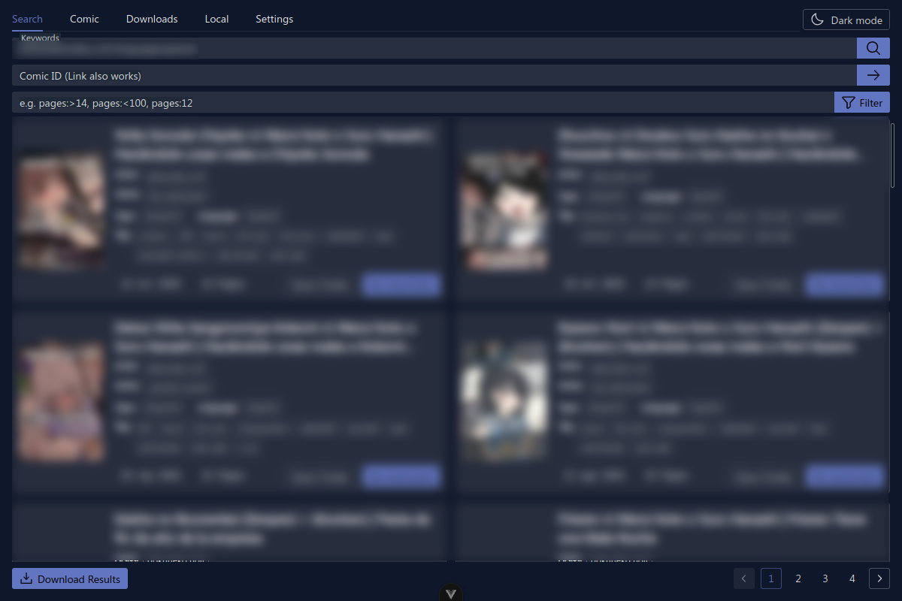

<p align="center">
    
</p>


# 📚 Hitomi Downloader

A GUI-based multi-threaded downloader for [hitomi.la](https://hitomi.la)

English / [Español](./README.es-ES.md) / [简体中文](./README.zh-CN.md)

## 📥 Download

Pre-compiled packages are available on the [Releases page](https://github.com/lanyeeee/hitomi-downloader/releases). Just download and use.

**Enjoying this project? feel free to support it with a GitHub Star⭐! Your support motivates me to keep updating and maintaining🙏**

## ✨ Features

| Feature                              | Description                                                  |
| ------------------------------------ | ------------------------------------------------------------ |
| 🖼️ GUI                               | Built with [Tauri 2](https://v2.tauri.app/start/) and Vue 3: lightweight, clean and easy to use. |
| 🔎 Search                            | Search by keywords, hitomi.la ID or URL, with autocomplete for artists, series, tags and languages. |
| 🎯 Filters                           | Narrow the current results with `pages:>14`, `pages:<100` or `pages:12`, and combine any operator supported by hitomi.la (`artist:`, `language:`, `series:`, `group:`, `type:`, ...). |
| ⚡ Multi-threaded downloading        | Maximize download speed.                                     |
| 📥 Bulk download                     | Collect every page of a search, filter and select the comics you want, then queue them sequentially. |
| 🗂️ Download queue                   | Live per-comic progress with pause, resume and cancel, plus right-click multi-select. |
| 📂 Export                            | One-click export to universal PDF or CBZ formats from the local library. |
| 🌐 Proxy support                     | Use the system proxy, no proxy, or a custom HTTP / SOCKS5 / SOCKS5H proxy with optional credentials, connection test and explicit save. |
| 🗂️ Customizable directory structure | Highly customizable directory structure and naming rules, supporting fields like type, author, language, etc. Say goodbye to the hassle of manual organization. |
| 🌓 Themes                            | Light, dark, or follow the system theme.                      |
| 🌐 Internationalization              | English, Spanish and Simplified Chinese, with a built-in multilingual system (i18n). |
| 📱 Responsive UI                     | Panes, cards and dialogs adapt from small windows to wide screens. |

## 🖥️ Screenshots

### Search and filters


### Comic details



### Bulk download



### Downloads and local library





### Settings and proxy



### Dark mode



## 📖 How to Use

1.  In the `Search` tab, type keywords or a hitomi.la ID/URL. Use operators such as `artist:name`, `language:spanish` or `pages:>20` to narrow the search.
2.  Click `Download` directly on a comic card, or click the cover/title to open the `Comic` tab, review the details and languages, and download from there.
3.  Follow the progress in the `Downloads` tab. Right-click a task to pause, resume or cancel it; double-clicking toggles pause/resume.
4.  To download many comics at once, click `Download Results`, filter the list, select what you want and start the queue. Tasks are downloaded one after another.
5.  Finished comics appear in the `Local` tab, where you can open their folder or export them to PDF/CBZ(ZIP).

📹 The video below demonstrates the full usage process. **It's Safe For Work, so feel free to watch.**

https://github.com/user-attachments/assets/d2d0e577-c074-41ca-996f-445d52e2cce5

## 🧭 Using a Proxy

If hitomi.la is not reachable from your network, open `Settings` and pick a proxy mode:

-   `System`: reuse the operating system proxy.
-   `No Proxy`: connect directly.
-   `Custom`: choose the protocol (`HTTP`, `SOCKS5` or `SOCKS5H`), enter host and port, and optionally a username and password. `SOCKS5H` lets the proxy resolve DNS, which is useful with Tor.

Click `Test Connection` to verify that the proxy can reach hitomi.la, then `Save` to persist the configuration. Credentials are stored in plain text inside `config.json`, so protect that file accordingly.

## ⚠️ About Antivirus False Positives

For individually developed projects, this issue is almost unavoidable (~~because it requires purchasing a digital certificate for software signing, or even paying protection fees to antivirus companies~~).
The only solutions I can think of are:

1.  Compile it yourself according to the **How to Build** instructions below.
2.  Trust my promise that everything you download from the [Release page](https://github.com/lanyeeee/hitomi-downloader/releases) is safe.

## 🛠️ How to Build

Building is very simple, just 3 commands.
~~Prerequisite you have Rust, Node, and pnpm installed.~~

#### 📋 Prerequisites

-   [Rust](https://www.rust-lang.org/tools/install)
-   [Node](https://nodejs.org/en)
-   [pnpm](https://pnpm.io/installation)

#### 📝 Steps

#### 1. Clone this repository

```
git clone https://github.com/lanyeeee/hitomi-downloader.git
```

#### 2. Install dependencies

```
cd hitomi-downloader
pnpm install
```

#### 3. Build

```
pnpm tauri build
```

## 🌐 Adding a New Language

Help with translating this project is welcome! If you want to add a new language, please refer to the implementation in [PR #1](https://github.com/lanyeeee/hitomi-downloader/pull/1). This PR shows how to add the localization files for `en-us`.

Main steps for adding a new language:

1.  Create a new language file in the `src/locales` directory.
2.  Translate the key-value pairs, following the format of the existing language files.
3.  Register the new language in `src/locales/index.ts`.
4.  Submit a PR.

## 🤝 Submitting PR

**Please submit Pull Requests to the `develop` branch.**

**If you want to add a new feature, please open an `issue` or `discussion` first to talk about it. This helps avoid wasted effort.**

For other cases, feel free to submit a PR directly, for example:

1.  🔧 Improvements to existing features.
2.  🐛 Bug fixes.
3.  🌐 Adding new language support.
4.  ⚡ Using a more lightweight library to implement existing features.
5.  📝 Documentation revisions.
6.  ⬆️  Pull Request for upgrading/updating dependencies will also be accepted.

## ⚠️ Disclaimer

-   This tool is intended for learning, research, and communication purposes only. Users should assume all risks associated with its use.
-   The author is not responsible for any losses, legal disputes, or other consequences resulting from the use of this tool.
-   The author is not responsible for the user's actions while using this tool, including but not limited to actions that violate laws or the rights of any third party.

## Thanks

[Pupil](https://github.com/tom5079/Pupil)

## 💬 Other

Any problems encountered during use or any features you would like to add, welcome to open a `issue` or `discussion`. I will do my best to address them.
