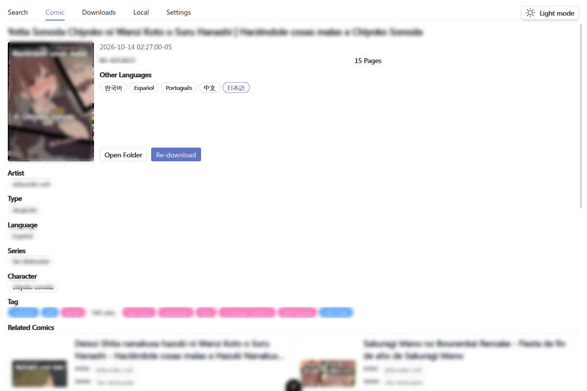
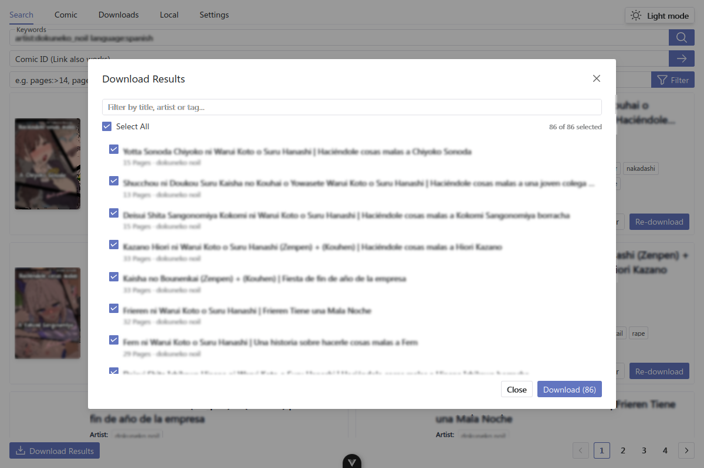
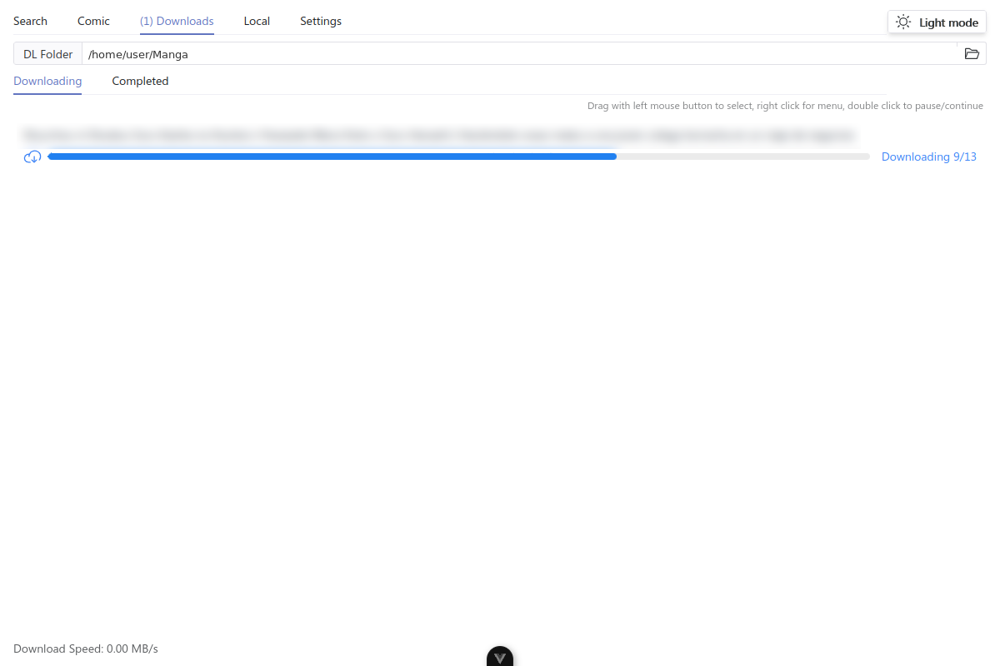
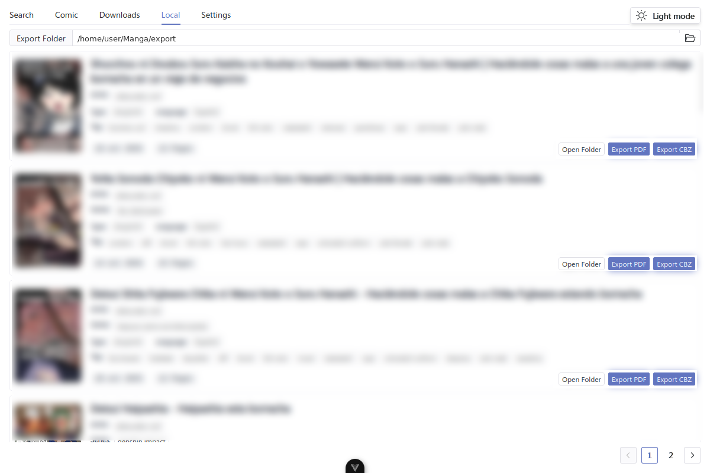
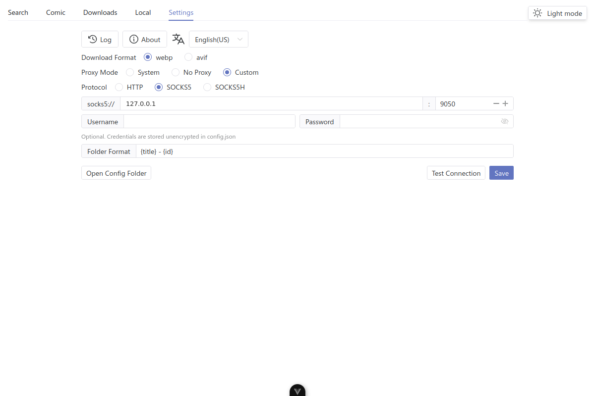
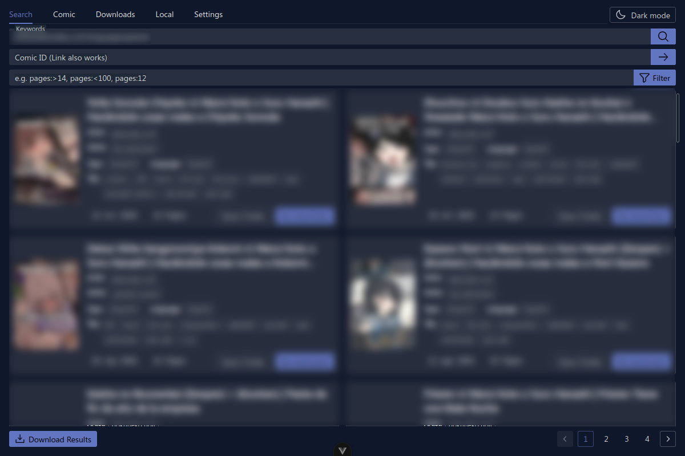

<p align="center">
    
</p>


# 📚Hitomi下载器

一个带GUI的用于 [hitomi.la](https://hitomi.la) 的多线程下载器

[English](./README.md) / [Español](./README.es-ES.md) / 简体中文

## 📥 快速下载

[Release页面](https://github.com/lanyeeee/hitomi-downloader/releases)提供了预编译的安装包，直接下载即可使用

**如果本项目对你有帮助，欢迎点个 Star ⭐ 支持！你的支持是我持续更新维护的动力 🙏**

## ✨ 主要特性

| 特性                   | 说明                                                         |
| ---------------------- | ------------------------------------------------------------ |
| 🖼️图形界面              | 基于 [Tauri 2](https://v2.tauri.app/start/) 和 Vue 3 构建，轻量、简洁、易用 |
| 🔎搜索                  | 支持关键词、hitomi.la ID 或链接搜索，并提供艺术家、系列、标签、语言等自动补全 |
| 🎯筛选                  | 使用 `pages:>14`、`pages:<100`、`pages:12` 筛选当前结果，并可组合 hitomi.la 支持的任意操作符（`artist:`、`language:`、`series:`、`group:`、`type:` 等） |
| ⚡多线程下载            | 最大化下载速度                                               |
| 📥批量下载              | 收集搜索的所有结果页，筛选并勾选需要的漫画，然后按顺序加入下载队列 |
| 🗂️下载队列             | 实时显示每本漫画的进度，支持暂停、继续、取消，以及右键多选   |
| 📂漫画导出              | 在本地库存中一键导出为通用的 PDF 或 CBZ 格式                 |
| 🌐代理支持              | 支持系统代理、无代理或自定义 HTTP / SOCKS5 / SOCKS5H 代理，可填写账号密码、测试连接并显式保存 |
| 🗂️自定义目录结构       | 高度可定制的目录结构和命名规则，支持类型、作者、语言等字段，彻底告别手动整理的烦恼 |
| 🌓主题                  | 浅色、深色或跟随系统                                         |
| 🌐国际化                | 内置多语言支持系统（i18n），目前包含英语、西班牙语和简体中文 |
| 📱响应式界面            | 面板、卡片和对话框可从小窗口适配到宽屏                       |

## 🖥️ 界面截图

### 搜索与筛选


### 漫画详情



### 批量下载



### 下载与本地库存





### 设置与代理



### 深色模式



## 📖 使用方法

1. 在 `搜索` 标签页输入关键词或 hitomi.la ID/链接。可使用 `artist:作者名`、`language:spanish`、`pages:>20` 等操作符缩小搜索范围。
2. 直接点击卡片上的 `下载`，或点击封面/标题进入 `漫画` 标签页，查看详情和其他语言后再下载。
3. 在 `下载` 标签页查看进度。右键任务可暂停、继续或取消；双击可在暂停/继续之间切换。
4. 想一次下载多本漫画时，点击 `下载结果`，筛选列表、勾选需要的漫画并开始队列，任务会依次下载。
5. 下载完成的漫画会出现在 `本地` 标签页，可以打开目录或导出为 PDF/CBZ(ZIP)。

📹 下面的视频是完整使用流程，**没有H内容，请放心观看**

https://github.com/user-attachments/assets/d2d0e577-c074-41ca-996f-445d52e2cce5

## 🧭 使用代理

如果你的网络无法访问 hitomi.la，请打开 `设置` 并选择代理模式：

- `System`（系统）：使用操作系统代理
- `No Proxy`（无代理）：直接连接
- `Custom`（自定义）：选择协议（`HTTP`、`SOCKS5` 或 `SOCKS5H`），填写主机和端口，可选填用户名和密码。`SOCKS5H` 由代理端解析 DNS，适合配合 Tor 使用。

点击 `Test Connection`（测试连接）验证代理能否访问 hitomi.la，然后点击 `Save`（保存）持久化配置。代理凭据会以明文保存在 `config.json` 中，请妥善保护该文件。

## ⚠️关于被杀毒软件误判为病毒

对于个人开发的项目来说，这个问题几乎是无解的(~~需要购买数字证书给软件签名，甚至给杀毒软件交保护费~~)  
我能想到的解决办法只有：

1. 根据下面的**如何构建(build)**，自行编译
2. 希望你相信我的承诺，我承诺你在[Release页面](https://github.com/lanyeeee/hitomi-downloader/releases)下载到的所有东西都是安全的

## 🛠️如何构建(build)

构建非常简单，一共就3条命令  
~~前提是你已经安装了Rust、Node、pnpm~~

#### 📋前提

- [Rust](https://www.rust-lang.org/tools/install)
- [Node](https://nodejs.org/en)
- [pnpm](https://pnpm.io/installation)

#### 📝步骤

#### 1. 克隆本仓库

```
git clone https://github.com/lanyeeee/hitomi-downloader.git
```

#### 2.安装依赖

```
cd hitomi-downloader
pnpm install
```

#### 3.构建(build)

```
pnpm tauri build
```

## 🌐 添加新语言

欢迎帮助翻译本项目！如果您想要为项目添加新语言，请参考 [PR #1](https://github.com/lanyeeee/hitomi-downloader/pull/1) 的实现方式。这个PR展示了如何添加`英语(美国)`的本地化文件

添加新语言的主要步骤：

1. 在 `src/locales` 目录下创建新的语言文件
2. 参照现有语言文件的格式和键值对进行翻译
3. 在 `src/locales/index.ts` 中注册新语言
4. 提交PR

## 🤝提交PR

**PR请提交至`develop`分支**

**如果想新加一个功能，请先开个`issue`或`discussion`讨论一下，避免无效工作**

其他情况的PR欢迎直接提交，比如：

1. 🔧 对原有功能的改进
2. 🐛 修复BUG
3. 🌐 添加新的语言支持
4. ⚡ 使用更轻量的库实现原有功能
5. 📝 修订文档
6. ⬆️ 升级、更新依赖的PR也会被接受

## ⚠️免责声明

- 本工具仅作学习、研究、交流使用，使用本工具的用户应自行承担风险
- 作者不对使用本工具导致的任何损失、法律纠纷或其他后果负责
- 作者不对用户使用本工具的行为负责，包括但不限于用户违反法律或任何第三方权益的行为

## 感谢

[Pupil](https://github.com/tom5079/Pupil)

## 💬其他

任何使用中遇到的问题、任何希望添加的功能，都欢迎提交issue或开discussion交流，我会尽力解决
